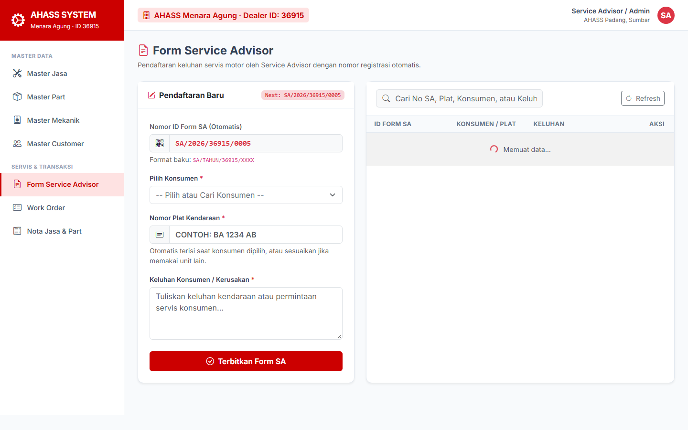
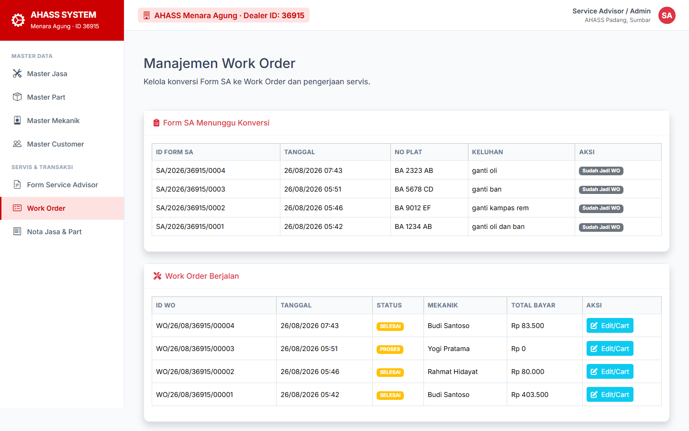
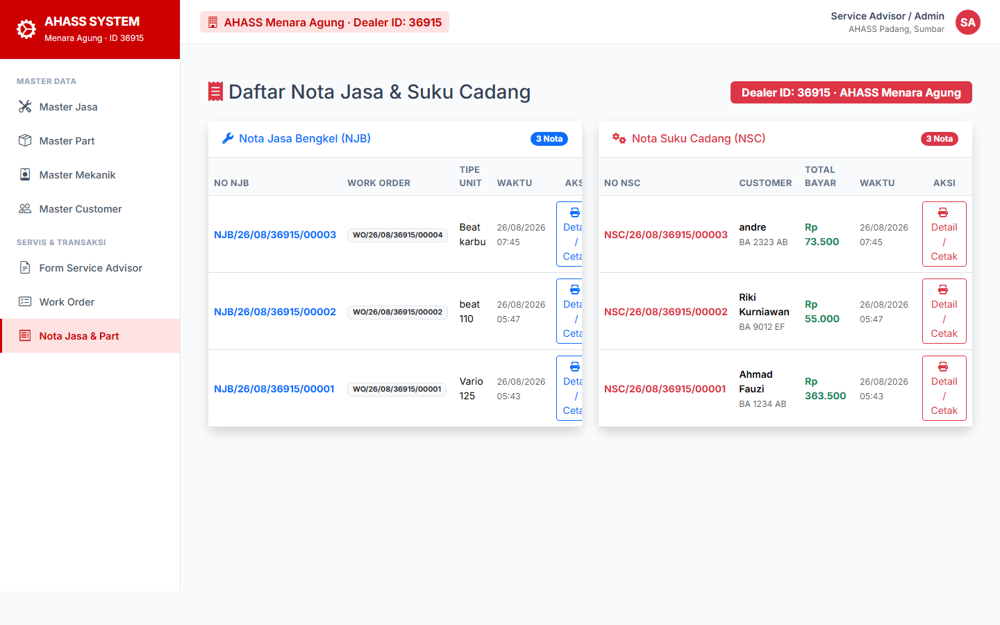
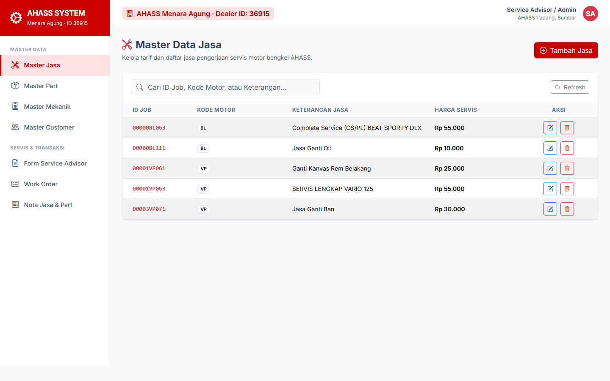
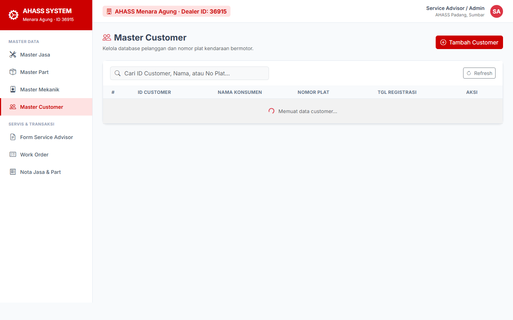

# Bengkel Management System (Service Advisor & Work Order)

Aplikasi berbasis web Laravel untuk mengelola operasional harian bengkel servis motor secara terintegrasi—mulai dari pendaftaran kendaraan oleh Service Advisor (SA), pengelolaan Work Order (WO) dengan penambahan suku cadang dan jasa secara realtime, hingga kalkulasi dan pencetakan nota transaksi otomatis.

Repository: [https://github.com/Biw-id/bengkel-management-test](https://github.com/Biw-id/bengkel-management-test)

---

## Antarmuka Aplikasi (Screenshots)

### 1. Form Service Advisor (Pendaftaran & Keluhan)
Pencatatan data kendaraan (Nomor Polisi, Tipe Motor), data pelanggan, keluhan awal, serta estimasi pekerjaan dengan auto-generated Form ID.



---

### 2. Work Order Management & Cart Realtime
Pengelolaan pengerjaan teknisi bengkel. Dilengkapi keranjang suku cadang dan jasa interaktif (AJAX) untuk menambah atau menghapus komponen pengerjaan sebelum pesanan ditandai selesai (*Complete*).



---

### 3. Nota Transaksi & Ringkasan Biaya
Rekapitulasi total tagihan jasa servis dan suku cadang secara otomatis dan akurat tanpa selisih pembulatan.



---

### 4. Modul Master Data
Pengelolaan katalog jasa servis, database suku cadang, data mekanik, dan direktori pelanggan.

| Master Jasa Servis | Master Sparepart |
| :---: | :---: |
|  |  |

| Master Pelanggan | Master Mekanik |
| :---: | :---: |
|  |  |

---

## Alur Bisnis Operasional

```
[Konsumen Datang] 
       │
       ▼
[Form Service Advisor] ──> Catat No. Polisi, Tipe Motor, & Keluhan
       │
       ▼
[Work Order (WO)] ───────> Tugaskan Mekanik & Input Cart (Jasa + Suku Cadang via AJAX)
       │
       ▼
[Penyelesaian WO] ───────> Validasi Hasil Servis & Suku Cadang
       │
       ▼
[Nota Transaksi] ────────> Cetak Bukti Pembayaran / Invoice Tagihan
```

---

## Fitur Utama

- **Form Pendaftaran (Service Advisor):** Pencatatan identitas konsumen, nomor polisi, dan keluhan awal kendaraan.
- **Work Order Engine:** Pembuatan tiket pengerjaan teknisi dengan sistem penambahan/penghapusan jasa dan suku cadang berbasis REST API/AJAX tanpa reload halaman.
- **Manajemen Katalog Suku Cadang & Jasa:** Pemantauan data suku cadang dan tarif jasa servis terstandar.
- **Auto-Generate Reference IDs:** Format kode unik terstandar untuk Form SA, Work Order, dan Nota Transaksi.
- **Kalkulasi Biaya Akurat:** Penjumlahan subtotal part dan jasa secara otomatis untuk meminimalisir kesalahan manual.

---

## Tech Stack

- **Backend Framework:** Laravel (PHP 8.2+)
- **Database:** MySQL
- **Frontend & Styling:** Blade Template, Tailwind CSS, JavaScript (AJAX / Axios)
- **Tooling:** Vite, Composer

---

## Menjalankan Proyek Secara Lokal

### Prasyarat
- PHP >= 8.1
- Composer
- MySQL Database
- Node.js & npm

### Langkah Instalasi

1. **Clone repository:**
   ```bash
   git clone https://github.com/Biw-id/bengkel-management-test.git
   cd bengkel-management-test
   ```

2. **Install dependensi PHP & Node:**
   ```bash
   composer install
   npm install
   ```

3. **Konfigurasi Environment:**
   Salin file `.env.example` menjadi `.env` lalu sesuaikan konfigurasi database:
   ```bash
   cp .env.example .env
   ```
   Atur koneksi database di `.env`:
   ```env
   DB_CONNECTION=mysql
   DB_HOST=127.0.0.1
   DB_PORT=3306
   DB_DATABASE=db_menara_agung
   DB_USERNAME=root
   DB_PASSWORD=
   ```

4. **Generate Application Key:**
   ```bash
   php artisan key:generate
   ```

5. **Jalankan Migrasi Database:**
   ```bash
   php artisan migrate
   ```

6. **Build Aset Frontend & Jalankan Server:**
   ```bash
   npm run build
   php artisan serve
   ```
   Aplikasi dapat diakses melalui browser di `http://localhost:8000`.

---

## Lisensi & Hak Penggunaan
Proyek ini dikembangkan sebagai prototipe sistem manajemen operasional bengkel terintegrasi (Studi Kasus Service Advisor PT Menara Agung).
